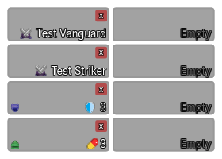
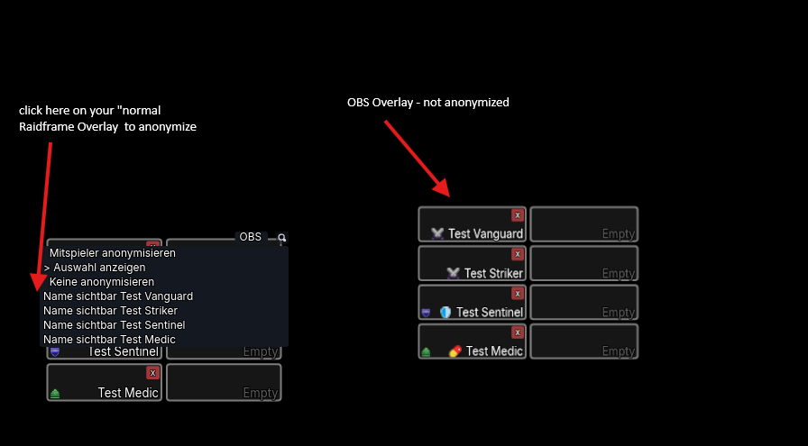
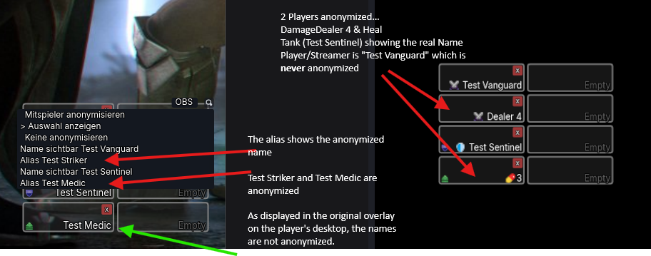

# BARAS Privacy Edition · v2026.11.13

[English](#english) · [Deutsch](#deutsch)

## English

### Windows and OBS

The Windows release executable is built as `target/release/app.exe`. Keep the accompanying parser executable beside it. The Privacy Edition shows an orange mascot in the title bar and beside the Privacy Edition label. It uses its own application identity and stores BARAS data under `%APPDATA%\baras-privacy`. The upstream updater is disabled.


Enable **Settings → Overlay Streaming Source**. In OBS, add a Browser Source using **http://127.0.0.1:47684/overlay** and enter the dimensions of your OBS canvas, for example 2560 × 1440. Enable the desired overlays in BARAS. Load a combat log copied into a dedicated test folder and select an encounter to populate the meters. The privacy settings apply to this browser source. Window and display captures show the respective local content. Notes, alerts and timers are omitted from the browser source.

### Role names and symbols

| Damage dealer | Tank | Healer |
| --- | --- | --- |
|  |  |  |
| `DamageDealer {n}` | `Tank {n}` | `Heal {n}` |

Check **Show SWTOR role icons in OBS meters** to use the bundled icons. The symbols appear before aliases and visible names when the player's role is known. For custom emoji instead, leave the checkbox off and enter templates such as `⚔️ Dealer {n}`, `🛡️{n}` and `💊{n}`. Without `{n}`, BARAS appends the number after a space. Leading symbols in a template are also used before revealed names. Enable both options only if you want both symbols. Click **Save player aliases** to apply and store your choices.

### Name visibility

In BARAS, enter **Rearrange raid frames** and click **OBS** beside the magnifier. The menu stays local.

| Mode | OBS output |
| --- | --- |
| **Anonymize other players** | Your character's name and aliases for every other player |
| **Show selected names** | Your character's name and the individual names you reveal |
| **Show all names** | Every player's name |

In **Show selected names**, click a player to switch between **Alias** and **Name shown**. Selection starts with other players aliased and resets when BARAS restarts. **Note: No players detected** means the raid frame is empty. The modes remain available. Under **OBS privacy language**, choose **English** or **Deutsch**, then save.



The local test character and Test Striker are visible. The tank and healer have aliases.

#### Example with four test players



With **Show selected names** active, all three teammates have been individually revealed.



Clicking Test Striker and Test Medic switches them back to **Alias**. OBS still shows Test Vanguard (your character) and Test Sentinel by name. The local raid frame continues to show all four names.

### Test with fictional players

Open PowerShell in the Privacy Edition project folder and use the existing isolated test profile. Leave OBS in preview. The commands below assume the test profile lives beside the project folder.

```powershell
$env:BARAS_PRIVACY_TEST_PROFILE = (Resolve-Path '..\baras-starttest-profile').Path
$env:BARAS_PRIVACY_TEST_RAID = '1'
Start-Process -FilePath '.\target\debug\app.exe' -WorkingDirectory '.\target\debug'
```

The local test profile and log copies are disposable and are not included in the release. Create a separate test profile with a config.toml pointing at your own disposable log copies before running these commands.

Use **Rearrange raid frames → OBS** to test the four roles and slots: local DD, second DD, tank and healer. Verify that switching modes or clicking a single name changes the OBS preview and leaves the menu local. This fixture is available in the debug build. The magnifier's matching against SWTOR's raid frames is a separate in-game check.

## Deutsch

### Windows und OBS

Der Windows-Release-Build liegt nach dem Bauen unter `target/release/app.exe`. Die mitgelieferte Parser-EXE gehört in denselben Ordner. Die orange Figur kennzeichnet die Privacy Edition in der Titelleiste und neben dem Privacy-Schriftzug. Die Edition verwendet eine eigene Anwendungskennung, speichert BARAS-Daten unter `%APPDATA%\baras-privacy` und hat den Updater des Originals deaktiviert.

Aktiviere **Settings → Overlay Streaming Source**. Lege in OBS eine Browserquelle mit **http://127.0.0.1:47684/overlay** an. Verwende die Abmessungen deiner OBS-Leinwand, etwa 2560 × 1440. Aktiviere die gewünschten BARAS-Overlays und öffne einen Kampf aus einer Kampflog-Kopie. Die Anonymisierung gilt für diese Browserquelle. Fenster- und Bildschirmaufnahmen zeigen die jeweilige lokale Darstellung. Notizen, Warnungen und Timer werden in der Browserquelle ausgelassen.

### Rollen und Vorlagen

Die [Beispielbilder oben](#role-names-and-symbols) zeigen die mitgelieferten SWTOR-Symbole für DD, Tank und Heiler. Aktiviere **Show SWTOR role icons in OBS meters**, um diese vor Alias oder sichtbarem Namen einzublenden. Für eigene Emojis kannst du die Option ausgeschaltet lassen und etwa `⚔️ Dealer {n}`, `🛡️{n}` und `💊{n}` verwenden. `{n}` steht für die Nummer je Rolle. Ohne Platzhalter wird sie mit Leerzeichen angehängt. Ein Symbol am Vorlagenanfang erscheint auch vor freigegebenen Namen. Mit beiden Optionen können beide Symbole sichtbar sein.

Wähle **Deutsch** unter **OBS privacy language** und speichere mit **Save player aliases**. Die Sprachwahl betrifft das Raidframe-Namensmenü und den Standardalias bei unbekannter Rolle.

### Namen freigeben

Öffne im Raidframe-Modus **Anordnen** den Button **OBS** neben der Lupe. Das Menü bleibt lokal.

- **Mitspieler anonymisieren** zeigt deinen Namen und Aliasse für alle Mitspieler.
- **Auswahl anzeigen** zeigt deinen Namen und einzeln freigegebene Namen. Klicke einen Mitspieler an, um zwischen **Alias** und **Name sichtbar** zu wechseln. Ein Neustart setzt die Einzelfreigaben zurück.
- **Keine anonymisieren** zeigt alle Namen.

**Hinweis: Keine Spieler erkannt** bedeutet, dass das Raidframe noch leer ist. Mit dem [isolierten Testprofil](#test-with-fictional-players) kannst du vier erfundene Charaktere anzeigen und die Modi sowie Einzelfreigaben offline in OBS prüfen. Die tatsächliche Zuordnung der Raidplätze per Lupe wird im Spiel geprüft.


Der eigene Testcharakter und der freigegebene Test Striker sind sichtbar. Tank und Heiler erscheinen als Alias.

#### Beispiel mit vier Testspielern


Unter **Auswahl anzeigen** sind alle drei Mitspieler einzeln freigegeben.


Ein Klick auf Test Striker und Test Medic setzt beide wieder auf **Alias**. OBS zeigt weiterhin Test Vanguard (deinen Charakter) und Test Sentinel namentlich. Im lokalen Raidframe bleiben alle vier Namen sichtbar.

### Testdateien und Änderungen

Original-BARAS, Privacy-AppData und SWTOR-Kampflogs sind getrennte Datenbereiche. Verwende für Archivieren, Wiederherstellen und Löschen ausschließlich Kampflog-Kopien in einem separaten Testordner. Das Archivieren entfernt die Quelldatei aus dem jeweils eingestellten Kampflogordner und legt sie komprimiert ab.

Die Privacy Edition übernimmt BARAS v2026.11.13. Die Privacy-Änderungen umfassen die separate Anwendungskennung und Datenablage, den deaktivierten Updater, die orange Kennzeichnung, die lokal gerenderte OBS-Browserquelle, farbige Emojis, Rollenvorlagen, SWTOR-Rollensymbole für Metrik-Overlays, Englisch/Deutsch und die Namensmodi im Raidframe. Der [BARAS-Changelog](../CHANGELOG.md) enthält die Upstream-Änderungen.


### Technische Änderungen und Veröffentlichung

- Die Privacy-Pfade gelten auch für Charakter-Roster, Verlauf, Archiv, Parser-Daten, Caches, eigene Effekte und Begegnungsdefinitionen, Töne, OCR-Modelle und OCR-Debugdateien.
- Die OBS-Quelle lauscht lokal. BARAS zeichnet ihre Bilder separat und leert den Zeichenpuffer vorher. Bei einem Wechsel der Namensfreigaben werden veraltete Bilder verworfen. Die lokale Raidframe-Bedienung bleibt in BARAS.
- Einzelfreigaben nutzen die Spieler-ID und gelten für die laufende Sitzung. Die Sprachwahl und Aliasvorlagen werden im Privacy-Profil gespeichert.
- Ein isoliertes Profil kann über BARAS_PRIVACY_TEST_PROFILE angegeben werden. Die vier erfundenen Raidspieler sind auf Debug-Builds beschränkt. Die mitgelieferten Upstream-Parser-Fixtures dienen der Entwicklung. Private Kampflogs, lokale Profile, Roster und Build-Ausgaben gehören nicht in den Fork.
- Der Quellstand basiert auf dem Upstream-Tag `v2026.11.13`. Lizenz und Upstream-Änderungsprotokoll bleiben Teil des Forks.
